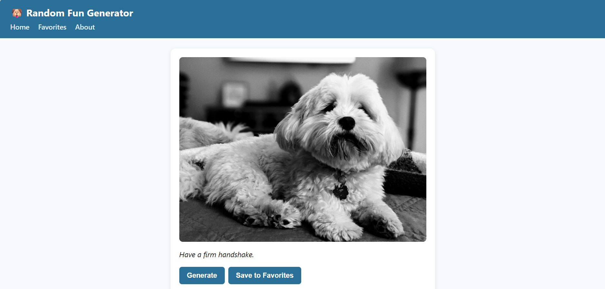
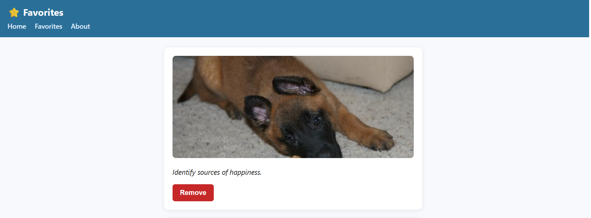

# 🐶 Random Fun Generator

A lightweight, three-page web app that pairs a random dog photo with a random piece of advice. No accounts, no ads, no tracking, everything runs in your browser.




---

## Live Demo

🔗 [https://randomfungenerator.onrender.com](https://randomfungenerator.onrender.com)

---

## Features

- **Random dog + advice pair** on page load
- **Generate** button fetches a fresh pair using `Promise.all`
- **Save to Favorites** stores pairs in `localStorage`
- **Favorites page** lists every saved pair with per-card **Remove** and a **Clear All** button
- **Loading, error, and empty states** throughout
- **Dynamic copyright year** in the footer
- **Responsive** layout from 375 px mobile up to desktop
- **Accessible**: alt text on all images, `aria-live` status messages, keyboard-navigable
- **No build step for the user** — just static files served by Vite

---

## Tech Stack

| Layer | Choice |
|---|---|
| Build tool | [Vite](https://vitejs.dev/) 5 |
| Language | Vanilla JavaScript (ES modules) |
| Styling | Plain CSS (Grid + Flexbox) |
| Persistence | `localStorage` |
| Hosting | Netlify (or Render, GitHub Pages) |
| Data | [Dog CEO API](https://dog.ceo/dog-api/), [Advice Slip API](https://api.adviceslip.com/) |

No framework, no dependencies beyond Vite as a dev tool.

---

## Getting Started

### Prerequisites

- Node.js 18+ and npm

### Install & Run

```bash
# 1. Clone the repo
git clone https://github.com/<your-username>/random-fun-generator.git
cd random-fun-generator

# 2. Install dev dependencies
npm install

# 3. Start the dev server
npm run dev